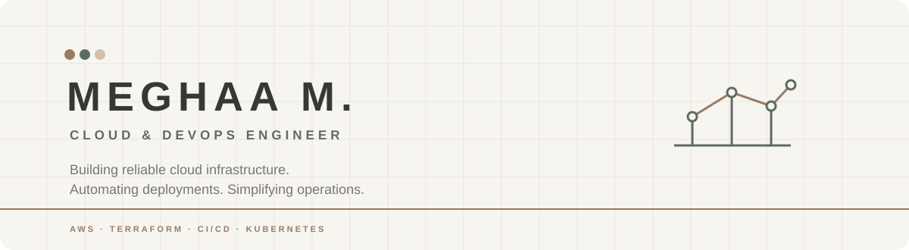

  

  
  
  

  

 

## Profile

I am a **Cloud & DevOps Engineer** in progress, pursuing a **B.Tech in Information Technology** at **KGiSL Institute of Technology** and graduating in 2027. My work is centered on making infrastructure repeatable, deployments observable, and operations easier to maintain.

I enjoy working with **AWS cloud infrastructure**, **Infrastructure as Code**, **CI/CD automation**, **containerization**, and **Linux administration**. My learning is project-led: I build practical systems that connect application development with reliable cloud delivery.

`B.Tech Information Technology` &nbsp;·&nbsp; `CGPA 8.46 / 10` &nbsp;·&nbsp; `KGiSL Institute of Technology`

---

## Engineering toolkit

### Cloud computing

          

### DevOps & delivery

         

### Infrastructure automation

  

### Systems, programming & observability

           

---

## Selected work

### [AWS Serverless Cost Optimisation System](https://github.com/MEGHAAMANICKAM/aws-cost-optimizer-ec2)

Automated idle EC2 detection with scheduled Lambda execution, CloudWatch CPU monitoring, tag-based filtering, and SNS notifications. Uses least-privilege IAM roles to keep the workflow focused and auditable.

`AWS Lambda` `EC2` `IAM` `CloudWatch` `EventBridge` `SNS` `Python`

**Verified outcome:** `$0.28/day` savings per instance.

### [Campus Lost & Found — Full-Stack DevOps Deployment](https://github.com/MEGHAAMANICKAM/Campus_Lost-Found-GitOps)

Containerized application delivery with GitHub Actions CI workflows, Docker Hub image publishing, Helm-based Kubernetes releases, ArgoCD GitOps synchronization, and Nginx Ingress routing.

`React` `Node.js` `MySQL` `Docker` `GitHub Actions` `Kubernetes` `Helm` `ArgoCD` `Nginx Ingress`

### [Terraform EC2 User Data Bootstrap](https://github.com/MEGHAAMANICKAM/terraform-ec2-userdata-bootstrap)

Reusable Terraform configurations provision an EC2 instance and automate Docker and Java installation through user data, with IAM roles, security groups, and environment-specific configuration.

`Terraform` `AWS EC2` `IAM` `Linux` `Bash`

### [End-to-End DevOps CI/CD Pipeline](https://github.com/MEGHAAMANICKAM/end-to-end-devops-cicd-pipeline)

Jenkins pipeline automation connected to GitHub webhooks, Docker image creation, container registry publishing, and Kubernetes deployment on AWS/Linux infrastructure.

`Git` `GitHub` `Jenkins` `Docker` `Kubernetes` `AWS` `Linux`

### [Smart Expense Splitter](https://github.com/MEGHAAMANICKAM/smart_expense_splitter)

Full-stack expense management with automatic balance calculation, expense tracking, and integrated backend and database workflows.

`HTML` `CSS` `JavaScript` `Node.js` `Express.js` `MongoDB`

[Open live demo →](https://smart-expense-splitter-lps4.onrender.com/)

---

## Certifications

| Credential | Issuer / identifier |
| :--- | :--- |
| **AWS Certified Cloud Practitioner** | CLF-C02 · 2025 |
| **Introduction to Jenkins** | Linux Foundation · LFS167 |
| **Introduction to Linux** | Linux Foundation · LFS101 |
| **AWS Educate Cloud Computing 101** | AWS Educate |
| **AWS Cloud Essentials Knowledge Badge** | AWS |

---

## Milestones

- **KITE Achiever Award**
- **First Place** — PyExpo Weather Forecasting Hackathon
- **Top 15** — U & Me Hackathon

---

## GitHub at a glance

  
  

  

  

Statistics are rendered from public GitHub activity. If an external card is temporarily unavailable, the source data remains available on my <a href="https://github.com/MEGHAAMANICKAM">GitHub profile</a>.

---

## Connect

  <a href="mailto:meghaa202005@gmail.com">meghaa202005@gmail.com</a> 
  <a href="https://www.linkedin.com/in/meghaa1524/">linkedin.com/in/meghaa1524</a> 
  <a href="https://github.com/MEGHAAMANICKAM">github.com/MEGHAAMANICKAM</a>

  Cloud infrastructure · delivery automation · thoughtful operations

